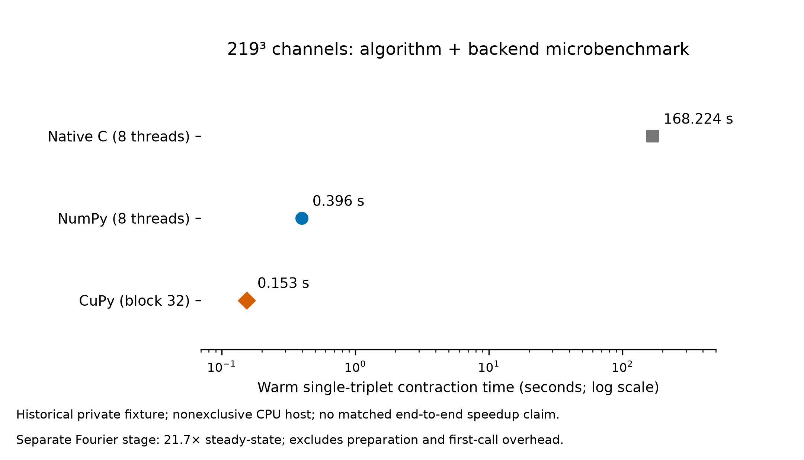
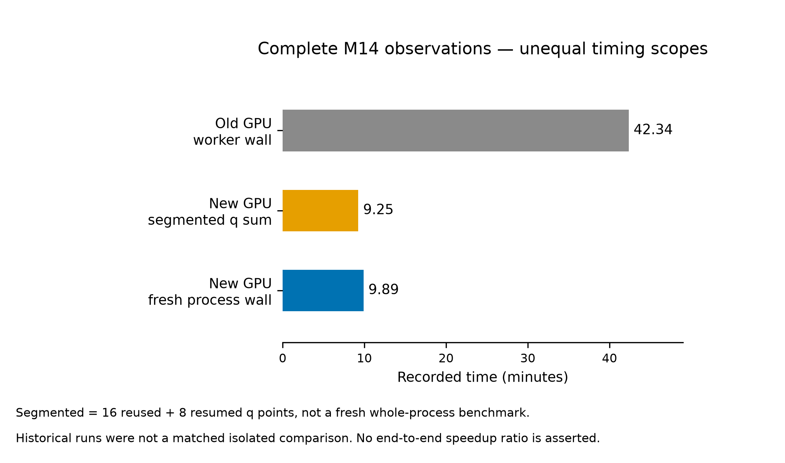
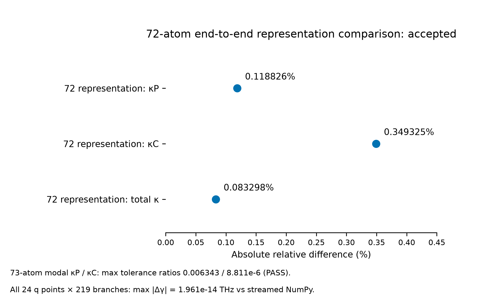

# phono3py-cupy-accelerator

**v0.1.0 — experimental, independent, not a production backend.**

FP64/complex128 NumPy and optional CuPy kernels for Phono3py real-to-reciprocal
FC3 transformation and normal-mode contraction. No mixed precision, frequency
repair, added linewidth, altered integration weights, or production monkey patch.
The adapter currently targets **Phono3py 3.31.1**, native `r0-average=True`,
`symmetrize_fc3q=False`, full or compact FC3 and dense shortest vectors.
Phono3py 4.x, other phase conventions and arbitrary WTE integrations are **not
validated** by this release.

## Install and run the public example

Use Python 3.12 in a new environment. Do not install into a production environment.

```bash
python -m venv .venv
# Activate .venv for your shell, then:
python -m pip install -e ".[dev,phono3py]"
python examples/minimal.py
python -m pytest -q
python benchmarks/benchmark_contraction.py --atoms 4 --backend numpy
python benchmarks/benchmark_fourier.py --backend numpy
python scripts/make_figures.py
python scripts/release_audit.py
```

The example generates a tiny **synthetic algebra fixture**, computes Fourier and
|V3|², and compares against the separately invoked upstream native-C interaction.
It does **not** predict a material's conductivity or solve Wigner transport.
`reference.py` supplies a small independent complex einsum oracle. No private
potential, force constants, structures, HDF5, custom WTE plugin, or accounts are needed.

For an explicitly available CUDA 12 device, install the optional CuPy extra:

```bash
python -m pip install -e ".[cuda12,phono3py]"
python examples/minimal.py --backend cupy
python benchmarks/benchmark_contraction.py --backend cupy
```

GPU regression is opt-in: set `ACCELERATOR_TEST_GPU=1` before pytest. Check that
the GPU is safely available first. Tests do not claim PASS when CUDA is absent.
Do not run these commands on a shared production GPU without its owner's approval.
The packaging revision has also passed an installed-wheel CPU/native-C/CUDA
integration check: 24 tests, zero failures and zero skips. See
[packaged-wheel validation](docs/packaged-wheel-validation.md). This is a fresh
synthetic correctness check, not a rerun of the private performance benchmarks
below. The delivered release report binds the check to the final wheel SHA256.

中文安装与使用说明：[使用说明](docs/INSTALL_ZH.md)。

## API and numerical contract

```python
from phono3py_cupy_accelerator import FourierBatch
from phono3py_cupy_accelerator.phono3py_adapter import evaluate_triplet

# pp is an existing Phono3py Interaction with solved phonons and fixed FC3.
engine = FourierBatch(pp, "numpy")  # or "cupy"; explicit choice
v3_squared, timings = evaluate_triplet(pp, triplet, backend="numpy", fourier=engine)
```

Eigenvectors use `(vertex, component, mode)`, with **no conjugation** of the three
normal-coordinate factors. The component cube interleaves atom and Cartesian
indices. All three native r0 legs, native nonzero mask, `all_shortest` factors,
prephase, signed frequency cutoff and native conversion factor are retained.
No zero-g screening is introduced into the contraction. Keep FC3, mappings and
grid unchanged while reusing an engine; create a new engine if inputs change.

The adapter returns per-triplet interactions, **not a drop-in replacement for
Phono3py's complete gamma/WTE driver**. Integration weights, Bose factors,
degeneracy handling, q weights, velocity operators and thickness normalization
remain the responsibility of an independently validated downstream driver.
No custom WTE plugin is distributed or modified here. No backend is registered
globally. Default packed-constant budget is 2 GiB (not a total GPU memory bound);
the phase cache is capped at 256 entries. The cubic dense algorithm remains
memory-intensive and is not a sparse or large-cell solution.

## Reported performance — keep the measurement scopes separate

The following are **historical software measurements on private fixtures**, not
new synthetic benchmark results. Raw scientific inputs cannot be redistributed.
RTX 5080 was used. Replotting the supplied summaries is reproducible; independently
reproducing those private material benchmarks is not possible from this repository.

| Scope | Native C | NumPy | CuPy |
|---|---:|---:|---:|
| Warm contraction, 219³ channels, one triplet | 168.224 s (8 threads) | 0.396 s (8 threads, block 32) | 0.153 s (block 32) |

The CPU host was **not exclusive**. C had one warm measurement; NumPy/CuPy values
are warm medians. The roughly 1098× C/CuPy ratio includes algorithmic
reorganization, **not pure GPU acceleration**. Same-algorithm NumPy/CuPy ratio
is about 2.58× for this particular microbenchmark. CuPy's first cold contraction
was 0.755 s. These block-32 measurements predate the full-first-GEMM fast path
packaged here; the public synthetic benchmark measures the current path instead.

The Fourier sample has **21.7× steady-state** acceleration across three sampled
triplets: native sum 3.628 s versus warm CuPy sum 0.1673 s. Preparation was 2.017 s
and the first CuPy call was 1.766 s, excluded from that ratio. Observed GPU process
peak was about 2.98 GB, not a guaranteed allocation maximum.

| Complete M14 observation | Recorded duration | Exact scope |
|---|---:|---|
| Old GPU contraction + original CPU Fourier | **42.34 min** | Worker wall; parent cold-process wall unavailable |
| New GPU Fourier + GPU contraction | **9.25 min** | Sum of q-point timings: 16 reused + 8 resumed; NOT fresh end-to-end |
| New GPU, separately saved fresh run | **9.89 min** | 593.249 s external full-process wall, including setup/WTE |

The historical runs were not an isolated, matched full-pipeline performance
experiment. Therefore **no fair end-to-end speedup ratio is claimed** from
42.34/9.25 or 42.34/9.89. CuPy pool reservation and sampled process memory are
different metrics; benchmark scripts label the scope instead of calling either
an exact hardware peak.




## Numerical evidence and known limits

The frozen ancestor completed a 73-atom / 219-branch / 24-irreducible-q M14
comparison against **complete streamed NumPy using the original CPU Fourier**.
The refactored release has separate synthetic/native-C CPU and installed-wheel
CUDA tests; it has not rerun the excluded private full-M14 inputs during packaging.

| Frozen private-fixture check | Error evidence | Status |
|---|---:|---|
| All 24 × 219 gamma values | max absolute 1.96108e-14 THz | PASS |
| Gamma, maximum error / reference peak | 7.56856e-14 | PASS |
| Gamma, maximum significant-mode relative error | 6.34370e-10 | PASS |
| Modal κP | max tolerance ratio 0.00634339 | PASS |
| Modal κC | max tolerance ratio 8.81113e-6 | PASS |
| Independent original native-C **all-q** reference | Incomplete; cannot serve as completed reference | **PENDING** |

All-q gamma comparisons used rtol 1e-8 plus per-q atol equal to 1e-12 times
reference peak. The modal κ test uses rtol 1e-7 and atol 1e-12 in unchanged native
output units; ratio = max(|error| / (atol + rtol |reference|)). Near-zero errors
are retained. Complete anonymized per-q error summaries are in
`benchmarks/data/gamma_accuracy_24q.csv`; no linewidth arrays are distributed.
The historical modal maximum absolute differences were 1.28119e-10 (κP) and
4.26048e-15 (κC) in native output units, not republished material conductivities.

### 72-atom pristine representation: accepted

The private strict-periodic 8 → 72 atom representation retained **216 branches**,
with the same physical sampling (8-atom M42 ↔ 72-atom M14). Harmonic and reciprocal
tensor folding prechecks passed. The complete WTE comparison is **accepted by
the project owner at the following measured precision**:

| Quantity | Absolute relative difference | Acceptance |
|---|---:|---|
| κP | 0.118826% | PASS — owner accepted |
| κC | 0.349325% | PASS — owner accepted |
| Total κ | 0.083298% | PASS — owner accepted |

The maximum reported difference is **0.349325%**. The earlier strict regression
criterion (rtol 1e-7, atol 1e-12) was not met; that original result is retained
alongside the owner's subsequent acceptance of these differences. The completed
comparison is 72-atom M14; no 72-atom M21 result is included. Absolute material
κ values and unpublished force constants are excluded.



## Reproducibility and release contents

- Public synthetic example, NumPy oracle and native-C regression: runnable.
- Public timing scripts: runnable on your explicitly available CPU/GPU; no hidden assets.
- Three figures: regenerated from the sanitized JSON/CSV, PNG + editable SVG + PDF.
- Historical private full-M14 gamma/WTE measurements: summaries only, **not independently reproducible** here.
- Full native-C all-grid reference: pending; no production migration approval.
- Packaging changes: removed 73-atom/4-image hardcoding, added input/version/memory
  guards and bounded cache; arithmetic remains the frozen three-leg/three-GEMM path.

See [validation](docs/validation.md), [benchmarking](docs/benchmarking.md),
[release checklist](docs/RELEASE_CHECKLIST.md), and [third-party attribution](THIRD_PARTY_NOTICES.md).
`requirements/tested-cpu.txt` records the isolated local validation environment.

## License and upstream credit

Project author: **yangdewei** — <1147398767@qq.com>.

BSD-3-Clause; Phono3py/Phonopy/Atsushi Togo notices are retained separately.
See [NOTICE](NOTICE) and [tagged upstream license](https://github.com/phonopy/phono3py/blob/v3.31.1/LICENSE).
This project is not affiliated with or endorsed by upstream developers.
Please cite Phono3py according to its own documentation when using it for science.

Figure QA was assisted by procedural scientific-visualization guidance described
by Kassis, Agarwal, He, Patel & Brueckner (2026),
[Scientific Agent Skills](https://doi.org/10.48550/arXiv.2609.00065).
This procedural acknowledgment is not numerical validation or upstream endorsement.
